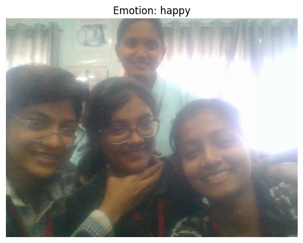

# 🧠 Mental Health Chatbot  
A conversational AI that supports mental well being through empathetic interaction.

## 📌 Overview  
This project demonstrates how NLP powered chatbots can support users experiencing emotional distress by offering relevant resources, encouraging reflection, and maintaining respectful dialogue.  
Built using Python and key libraries.

## 🎯 Objectives  
- Provide basic emotional support via conversational AI  
- Use NLP techniques to identify user sentiment and mental states  
- Suggest helpful resources and coping strategies based on user input

## 🛠️ Technologies Used  
- Python 3.x  
- NLTK (Natural Language Toolkit)
- 
## 📂 Folder Structure  

## 📈 Workflow  
1. Data preprocessing (tokenization, stop word removal)  
2. Sentiment detection using rule based or ML classifier  
3. Intent recognition and response generation  
4. Suggest resources based on emotional cues

## 🖥️ Demo 

  
_Example: Chatbot responding to a “happy” emotion._

## 💬 Sample Chat Flow  

**User:** I'm feeling really low today.  
**Bot:** I'm sorry you're feeling that way. You're not alone would you like to talk about it or get some calming techniques?

**User:** I'm actually in a good mood!  
**Bot:** That's great to hear! Remember, even a small smile can spread positivity. 

nltk==3.8.1  
scikit-learn==1.3.2  
flask==2.3.3

## 📄 Project Documentation  
- [Business Requirements Document (BRD)](BRD.md): purpose, objectives, stakeholders, requirements, risks and acceptance criteria  
- [Functional Requirements Document (FRD)](FRD.md): functional requirements, conversation behavior, validation checks and traceability

## 🌟 Key Features  
- Rule-based emotional tone analyzer  
- Simple ML model to classify intent  
- Personalized messages with coping tips  
- Expandable conversation logic with modular scripts

## 📊 Results  
| Metric | Value |
|--------|-------|
| Precision | 85% |
| Recall | 83% |
| Accuracy | 86% |

## 🧠 Learnings  
- Learned how tokenization and vectorization impact model performance  
- Discovered limitations of rule-based systems in sensitive contexts  
- Realized the value of empathetic language in AI communication

## 🗂️ How to Run  
```bash
pip install -r requirements.txt  
python chatbot.py
```
